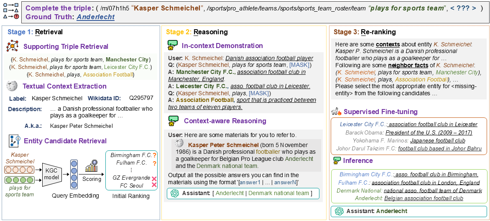

# [NAACL2025] Retrieval, Reasoning, Re-ranking: A Context-Enriched Framework for Knowledge Graph Completion

This repository provides the official implementation of the paper *"Retrieval, Reasoning, Re-ranking: A Context-Enriched Framework for Knowledge Graph Completion"*.



## Experiment Environment Setup
Create a python environment and install the required packages.
For detailed Python package versions, you may refer to the suggested settings listed in `requirements.txt` from [LLaMA-Factory](https://github.com/hiyouga/LLaMA-Factory/blob/main/requirements.txt). (VLLM is not required) 

## Dataset

1. Download the full dataset and LLM instructions from this [link](https://drive.google.com/drive/folders/1glyckpLcIMYK6QfvYHoJluLxRycxEbef?usp=sharing) .

2. Move the data folder into this project directory.

## LLM Setup

You may download LLM checkpoints from the following links:
- [Qwen2-7B-Instruct](https://huggingface.co/Qwen/Qwen2-7B-Instruct)
- [Meta-Llama-3-8B-Instruct](https://huggingface.co/meta-llama/Meta-Llama-3-8B-Instruct)

## Training Prompt Construction

```bash
python3 rrr_kgc_mc_train_prompt_construction.py --dataset WN18RR --use_ctx --kge SimKGC --num_nb_tps 10 --start 0 --end 86835 --rerank_scope 20
```

## Instruction-tuning

Please refer to the official document of [LLaMA-Factory](https://github.com/hiyouga/LLaMA-Factory/) to conduct LLM supervised fine-tuning. You may need to specify the prompt path and other training settings in a configuration file. Detailed hyper-parameters are provided in our paper. 

## Reasoning 

```bash
python3 reasoning.py --dataset WN18RR --rank --model_name GPT --model_path /your/model/path/if/not/using/GPT/ --fs_ctx --wiki_ctx --fsl 2 --start_idx 0 --end_idx 3134
```

## Test Prompt Construction
Here, the LLM parameter stands for the LLM used for conducting "reasoning" in the last step, NOT the one being fine-tuned. 

```bash
python3 rrr_kgc_mc_prompt_construction.py --dataset WN18RR --reasoning --use_ctx --kge SimKGC --llm GPT --num_nb_tps 10 --start 0 --end 3134 --rerank_scope 20
```

## Evaluation
Here, the LLM parameter stands for the LLM used for conducting "reasoning" in the last step, NOT the one being fine-tuned. 

```bash
python3 rrr_kgc_mc_test.py --dataset WN18RR --use_ctx --reasoning --kge SimKGC --llm GPT --start 0 --end 3134 --llm_batch_size 1 --model_path /your/model/path
```

## Citation

If you find this code useful, please consider citing the following paper.
```
@inproceedings{li-etal-2025-retrieval,
    title = "Retrieval, Reasoning, Re-ranking: A Context-Enriched Framework for Knowledge Graph Completion",
    author = "Li, Muzhi  and
      Yang, Cehao  and
      Xu, Chengjin  and
      Jiang, Xuhui  and
      Qi, Yiyan  and
      Guo, Jian  and
      Leung, Ho-fung  and
      King, Irwin",
    editor = "Chiruzzo, Luis  and
      Ritter, Alan  and
      Wang, Lu",
    booktitle = "Proceedings of the 2025 Conference of the Nations of the Americas Chapter of the Association for Computational Linguistics: Human Language Technologies (Volume 1: Long Papers)",
    month = apr,
    year = "2025",
    address = "Albuquerque, New Mexico",
    publisher = "Association for Computational Linguistics",
    url = "https://aclanthology.org/2025.naacl-long.221/",
    doi = "10.18653/v1/2025.naacl-long.221",
    pages = "4349--4363",
    ISBN = "979-8-89176-189-6"
}
```

## Related Works
KGR3 is not designed to handle inductive knowledge graph completion. If you're interested in performing inductive KGC with LLMs, we recommend exploring our work,  [CATS](https://github.com/RaynorLEE/CATS). 

## Acknowledgement
We refer to the code of [DIFT](https://github.com/nju-websoft/DIFT). Thanks for their contributions.
