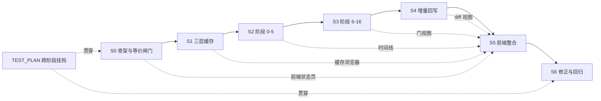

# 后端 / 前端 / 中间结果展示 / 调试 / 测试 —— 分阶段实施计划（总索引）

> 版本 1.0 · 2026-11-15
> 上游依据：[`../SCIFORGE_INTEGRATION_BLUEPRINT.md`](../SCIFORGE_INTEGRATION_BLUEPRINT.md)、[`../DYNAMIC_ONTOLOGY_NODE_CACHE.md`](../DYNAMIC_ONTOLOGY_NODE_CACHE.md)
> 输出目录：`/home/zengshuxin/molecular_algrithem_design/docs/plan/`
> 本计划把蓝图 P0–P5 展开为 **S0–S6 七个可独立验收的阶段**，每阶段一份文档，统一包含：后端设计 / 构建步骤 / 修正清单 / 前端相应设计 / **中间结果展示与调试计划表** / **测试计划（测试挂钩）** / 验收标准 / 交付物与回滚。

---

## 1. 现状基线（实测，不是假设）

| 项 | 实际值 | 计划含义 |
|---|---|---|
| 后端框架 | **FastAPI**（`web/server.py`，`app = FastAPI(title="CapFactory", version="6.0.0")`） | 新增 API 用 `app.add_api_route`，不用蓝图 |
| 路由注册 | `WEB_API_MODULES` 11 个模块显式注册；失败记入 `app.state.api_registration_errors`，`/api/status` 暴露 | S0 起把 `paperapp_api` 加进清单；**注册失败必须能在 `/api/status` 看到** |
| 页面 | `/`、`/data`、`/relations`、`/pipeline`、`/pipeline/extract`、`/repro` | 新页面用同一套 `_page()` / `HTMLResponse` 范式 |
| 前端技术栈 | **原生 HTML + 原生 JS + `fetch`**，无构建、无框架；`/static` 挂载；`app.css` | 不引入 npm/Vite/React；新页面复用 `repro.html` 的 CSS 变量与 `esc()`/`tbl()` |
| 主题变量 | `--bg:#080e18 / --pnl:#0c1526 / --bd:#1d2940 / --tx:#cfe0ff / --ok:#3ddc97 / --bad:#ff6b6b / --warn:#ffb454 / --acc:#8fb4ff` | 所有新页面统一 |
| 新增 API 范式 | `repro_api.py::_V9` 列表 + `register(app)` 去重（按已有 `app.routes` 的 path） | S1 起照抄 `_V10` 结构 |
| 图源 | `web/graph_source.py` 默认读 `batch10_app_v1.json`（**不是** `app_generation.json`），带 `FIELD_ALIAS` / `TYPE_ALIAS` 兼容映射 | 动态节点**不要**塞进 `graph_source`，用独立 API 直读 `app_generation.json`，避免污染既有页面 |
| API 版本 | `/api/v6/*`、`/api/v8/*`（含 `/api/v8/task/specs`）、`/api/v9/repro/*` | 新 API 统一 `/api/v10/paperapp/*` |
| 6 态 verdict | `sciforge/contracts.py::VERDICT_STATES = (PASS, WARN, FAIL, NOT_APPLICABLE, BLOCKED, ERROR)` + `validate_verdict()` | 26 阶段门控直接复用 |
| 启动 | `bash scripts/serve.sh 8091` → `stages/5_frontend/serve.py` → `capfactory.cli serve` | 每阶段验收都用它 |
| 冒烟 | `bash scripts/smoke.sh`（10 项 API 结构检查） | 每阶段都要扩 `smoke.sh` 并全绿 |
| 重建 | `bash scripts/rebuild.sh`（关系索引 / 溯源索引 / 页面快照） | S0 等价性闸门的对照基准 |
| 测试 | `tests/` 8 个 unittest：`test_lifecycle / test_nx_adapter / test_paradigm_batch / test_reproduction_molminer / test_rubric_runtime / test_rubric_tree / test_slice_baseline / test_vocab_standard` | 新增 `tests/test_paperapp_*.py`，不建 `tests/Phase/` |
| 解释器 / 路径 | `python3`（anaconda3）；`storage_cf -> storage` 软链 | 命令一律 `PYTHONPATH=src python3 -m ...` |
| 语义层 | `semantic/tbox_v4.py` 6 类/9 关系；`batch10_semantic_v4.json` 6001 节点/7460 断言 | **全程冻结** |
| 应用层 | `applayer/tbox.py` 8 类/9 关系；`app_generation.json` 8853 节点；`app_reproduction.json` 8300/10260 | 增量回写目标仅 `app_generation.json` |

---

## 2. 阶段总表

| 阶段 | 文档 | 核心目标 | 后端 | 前端 | 硬门 |
|---|---|---|---|---|---|
| **S0** | [S0-foundation.md](S0-foundation.md) | 骨架 + 动态类注册 + **重建等价性闸门** | 新建 `paperapp/{__init__,tbox,registry}.py`；改 `tasks.py`/`builder.py`/`config.yaml`/`server.py` | `/paperapp` 状态页 + 基线快照对比 | 语义层 SHA256 不变；`rebuild ≡ incremental` |
| **S1** | [S1-cache.md](S1-cache.md) | 三层缓存 + 四态生命周期 + 对齐/验证/晋升 | `nodecache.py` / `align.py` / `validate.py` / `promote.py` | 缓存浏览器（L1/L2/L3 + 冲突 + 晋升） | 同 key 二次 `llm_calls=0`；LLM 节点不进语义层 |
| **S2** | [S2-pipeline-front.md](S2-pipeline-front.md) | 26 阶段前半（0–5）+ `compile_paperspec()` | `paperspec.py` / `phasegraph.json` / `gates.py` / 4 个 miner | 阶段时间线（0–5）+ 单阶段产物抽屉 | `spec_hash` 幂等；零 LLM 编译 |
| **S3** | [S3-pipeline-back.md](S3-pipeline-back.md) | 26 阶段后半（6–16）+ 6 态门 + 运行时隔离 | `runner.py` / 12 个阶段适配器 / `events.ndjson` | 阶段时间线（6–16）+ 门 verdict 视图 | 全部 gate 有 verdict；run 隔离 |
| **S4** | [S4-materialize.md](S4-materialize.md) | 增量回写 / 失效 / 最小重算 / 跨 run 回放 | `materialize.py` / `replay.py` / `dependency_index` | 回写 diff 视图 + stale 面板 | `PROMOTION_LOG` append-only；`stale_recompute_scope < 5%` |
| **S5** | [S5-frontend.md](S5-frontend.md) | 统一前端设计：设计系统 / 4 页 / 调试面板 / 错误态 | `paperapp_api.py` 全量 API + 静态资源 | 设计系统 + 路由 + 组件 + 可访问性 | `smoke.sh` 全绿；零 console error |
| **S6** | [S6-hardening.md](S6-hardening.md) | 修正 / 全量回归 / 性能 / 安全 / 迁移 / 报告 | 修正清单闭环 + 指标报告 CLI | 空态/错误态/降级 | 8 项验收指标达标 + 全量回归 |

**测试总表**：[TEST_PLAN.md](TEST_PLAN.md)（跨阶段测试挂钩编号 `T-Sn-xx`、夹具、命令、判据、失败处理、覆盖率目标）。

---

## 3. 阶段依赖图



> **前端增量与整合的分工**：S0–S4 每阶段只做「该阶段需要的最小可视化」，用于中间结果展示与调试；S5 收拢成统一设计系统、补齐通用组件/错误态/可访问性/性能，并删除各阶段的临时占位。**不重复造页面**。

---

## 4. 统一阶段文档模板（每份都按此 10 节）

| 节 | 内容 |
|---|---|
| 0 | 阶段卡：目标、依赖、周期、交付物、一句话验收 |
| 1 | **后端设计**：文件清单（新建/修改）、数据结构、函数签名、配置、关键算法步骤 |
| 2 | **构建步骤**：Step 1..N，每步写明「改什么 / 写什么 / 即时怎么验」 |
| 3 | **修正清单**：预判会踩的坑 + 触发信号 + 修法 + 回归测试编号 |
| 4 | **前端相应设计**：页面/组件、API 契约（路径/方法/请求/响应/错误码）、状态机、交互、空/错/加载态 |
| 5 | **中间结果展示与调试计划表**：`# / 中间产物 / 生成时机 / 展示位置 / 调试命令 / 日志与事件 / 正常判据 / 异常信号 / 修复动作` |
| 6 | **测试计划（挂钩）**：单元 / 集成 / API / 前端 / 回归，编号对应 `TEST_PLAN.md` |
| 7 | **验收标准**：硬门（must）、指标（should）、退出条件、人工签字项 |
| 8 | 交付物清单 + 回滚方式 |
| 9 | 上下游接口（本阶段产出被谁消费） |

---

## 5. 跨阶段验收矩阵（硬门，任一不过不得进下一阶段）

| # | 硬门 | 首次出现 | 判据 | 校验命令 |
|---:|---|---|---|---|
| H1 | 语义层冻结 | S0 | `batch10_semantic_v4.json` SHA256 在所有 run 前后**完全相同** | `sha256sum storage/sciforge/batch10_semantic_v4.json` |
| H2 | 重建等价 | S0 | `build_task_layer("generation")` 全量 ≡ 上一版 ⊕ delta，逐节点/逐断言一致 | `python3 -m capfactory.paperapp.cli verify-rebuild` |
| H3 | 基础契约不变 | S0 | `SEMANTIC_CLASSES` 6、`APP_CLASSES` 8、`APP_RELATIONS` 9 | `python3 -m unittest tests.test_vocab_standard -v` |
| H4 | 缓存幂等 | S1 | 同 `request_key` 第二次 `llm_calls == 0` 且 `output_sha` 相同 | `tests/test_paperapp_cache.py::T-S1-03` |
| H5 | LLM 节点隔离 | S1 | 任何 `attribution="llm_proposal"` 节点都**不在**语义层图里 | `python3 -m capfactory.paperapp.cli audit-isolation` |
| H6 | spec 幂等 | S2 | `compile_paperspec()` 连续两次 `spec_hash` 相同 | `tests/test_paperapp_spec.py::T-S2-02` |
| H7 | 门完整 | S3 | 26 阶段每个 gate 都有 6 态 verdict，无静默 skip | `python3 -m capfactory.paperapp.cli audit-gates` |
| H8 | 回写可追溯 | S4 | `PROMOTION_LOG.jsonl` 只增行；每个 registered 节点带 `evidence_ids + run_id + attribution` | `python3 -m capfactory.paperapp.cli audit-promotions` |
| H9 | 前端注册无错 | S5 | `/api/status` 的 `api_registration_errors == {}` | `curl -s localhost:8091/api/status \| python3 -m json.tool` |
| H10 | 冒烟全绿 | S5/S6 | `scripts/smoke.sh` 原有 10 项 + 新增项全 PASS | `bash scripts/smoke.sh` |
| H11 | 回归全绿 | S6 | `unittest discover -s tests` 全部通过，无 skip-as-pass | `python3 -m unittest discover -s tests -p "test_*.py" -v` |

---

## 6. 命令总表

| 用途 | 命令 |
|---|---|
| 启动前端 | `bash scripts/serve.sh 8091` |
| 重建派生层 | `bash scripts/rebuild.sh` |
| API 冒烟 | `bash scripts/smoke.sh http://127.0.0.1:8091` |
| 全量单测 | `python3 -m unittest discover -s tests -p "test_*.py" -v` |
| 单阶段测试 | `python3 -m unittest tests.test_paperapp_s1 -v` |
| CLI 总入口 | `PYTHONPATH=src python3 -m capfactory.cli status` |
| paperapp CLI | `PYTHONPATH=src python3 -m capfactory.paperapp.cli --help` |
| 跑一次生成 | `PYTHONPATH=src python3 -m capfactory.paperapp.cli run --arxiv 2411.06608 --effort balanced` |
| 缓存状态 | `PYTHONPATH=src python3 -m capfactory.paperapp.cli cache-status` |
| 调试单阶段 | `PYTHONPATH=src python3 -m capfactory.paperapp.cli debug-stage --run <run_id> --stage 4broad` |
| 晋升提案 | `PYTHONPATH=src python3 -m capfactory.paperapp.cli promote --proposal <id> --approve` |
| 审计 | `PYTHONPATH=src python3 -m capfactory.paperapp.cli audit-isolation\|audit-gates\|audit-promotions\|verify-rebuild` |
| 语义层哈希 | `sha256sum storage/sciforge/batch10_semantic_v4.json` |

> 所有命令在仓库根执行；**全部写入工作区路径，不使用删除命令**。缓存与 run 产物只追加、标 `valid_to`，不清理目录。

---

## 7. 进度看板（实施时逐项勾选）

- [x] S0 骨架 + 等价闸门（H1/H2/H3）
- [x] S1 三层缓存 + 四态（H4/H5）
- [x] S2 阶段 0–5 + PaperSpec（H6）
- [x] S3 阶段 6–16 + 门（H7）
- [x] S4 增量回写 + 失效（H8）
- [x] S5 前端整合（H9/H10）
- [x] S6 修正与全量回归（H11 + 8 项指标）
- [x] `docs/plan/` 各阶段「验收签字」小节填写实测值

---

## 8. 风险总表

| 风险 | 阶段 | 缓解 |
|---|---|---|
| 增量回写与全量重建分叉 → 缓存成第二真相源 | S0/S4 | H2 每次回写前强制，`DRIFT` 即拒绝 |
| `graph_source.py` 读的是 `batch10_app_v1.json`，动态节点若塞进去会污染既有页面 | S0/S5 | 独立 `/api/v10/paperapp/*` 直读 `app_generation.json`，**不改 graph_source** |
| `WEB_API_MODULES` 漏注册导致 404 且静默 | S0 | `/api/status` 暴露 `api_registration_errors`，冒烟加断言 |
| 缓存键漏版本维度 → 旧结果错误复用 | S1/S4 | 四维绑定 + 变更即 `cache_miss` |
| 向量近邻跨论文合并 → 假事实 | S1 | 只在同 `paper_id + stage` 内近邻；0.92–0.98 不算命中 |
| 26 阶段一次做完无法定位故障 | S2/S3 | 每阶段独立 `events.ndjson` 事件 + `debug-stage` 单阶段重放 |
| 前端临时占位页堆积 | S5 | S5 统一收拢并删占位（标 `valid_to`，不物理删除历史） |
| 降低阈值刷缓存命中率 | S1/S6 | 阈值写进 `config.yaml` 且由测试锁定；指标异常升高即审计 |
| 改 `builder.py` 破坏既有 8 个测试 | S0 | 只加可选参数，默认行为不变；H11 每阶段都跑 |

---

## 9. 文档索引

| 文件 | 阶段 |
|---|---|
| [README.md](README.md) | 本索引 + 验收矩阵 + 命令总表 |
| [S0-foundation.md](S0-foundation.md) | S0 |
| [S1-cache.md](S1-cache.md) | S1 |
| [S2-pipeline-front.md](S2-pipeline-front.md) | S2 |
| [S3-pipeline-back.md](S3-pipeline-back.md) | S3 |
| [S4-materialize.md](S4-materialize.md) | S4 |
| [S5-frontend.md](S5-frontend.md) | S5 |
| [S6-hardening.md](S6-hardening.md) | S6 |
| [TEST_PLAN.md](TEST_PLAN.md) | 跨阶段测试挂钩总表 |

上游方案：[`../SCIFORGE_INTEGRATION_BLUEPRINT.md`](../SCIFORGE_INTEGRATION_BLUEPRINT.md) · [`../DYNAMIC_ONTOLOGY_NODE_CACHE.md`](../DYNAMIC_ONTOLOGY_NODE_CACHE.md)

---

## 10. v2 反思与增量修订（2026-11-15）

> 主文档：[`../DESIGN_REFLECTION_V2.md`](../DESIGN_REFLECTION_V2.md) · 补丁：[`V2_DELTA.md`](V2_DELTA.md)
> **阶段编号 S0–S6 不变、既有 126 项测试编号不变、H1–H11 不变**；v2 以增量补丁 + `T-V2-xx` 新编号并入。

### 10.1 v1 的 4 个结构性缺口

| # | 缺口 | v2 修正 |
|---:|---|---|
| G1 | 人只在「approver / 人工签字 / KILL」出现，不能提出方向或方法 | 新增 `HumanIntent / HumanHypothesis / MethodAlternative / ChoicePoint / HumanDecision / HumanOverride` 六类，人的思路进 idea DAG |
| G2 | 人选择后没有传播机制 | `CONSTRAINT_REINJECTION.json` 每边界逐字复述；决定进入 `spec_hash`；`SUPERSEDES` 触发最小重算 |
| G3 | 探索信号只有「成功注册」才算捕捉 | 四层漏斗：L0 `KnowledgeSignal`（100% 捕捉）→ L1 提案 → L2 注册 → L3 `Lesson/ExplorationFrontier` |
| G4 | 语义层挖掘只有 8 个「字段提升」miner，无结构派生与覆盖率 | 新增 D1–D4 确定性派生视图 + 复用 `research/gaps.py::CoverageAnalyzer` 生成 `MINING_COVERAGE.json` |

### 10.2 七条不变量（v2 宪法）

`I1 事实主权`（语义层冻结）· `I2 单真相源`（增量≡全量）· **`I3 全谱留痕`（未命中/被拒/失败/未尝试都成节点）** · **`I4 人类主权`（gate 超时只能 BLOCKED）** · **`I5 决定可传播`** · `I6 确定性优先` · `I7 可演进不失稳`。

一句话：**事实不被编造、探索不被丢失、方向不被机器独占、每个决定可追溯且能重算**。

### 10.3 新增 5 个硬门（合计 16）

| # | 硬门 | 判据 | 命令 |
|---:|---|---|---|
| H12 | 探索信号零丢失 | `signal_capture_rate == 1.0`；dismiss 100% 有理由 | `cli audit-signals` |
| H13 | 人类决定可追溯 | 每个 gate 有 `HumanDecision` + verdict；日志只增行 | `cli audit-decisions` |
| H14 | 人类主权 | gate 超时 BLOCKED；无路径把 LLM 提案写进语义层 | `cli audit-sovereignty` |
| H15 | 决定可传播 | `decision_propagation_rate == 1.0`；`spec_hash` 含决定集 | `cli audit-reinjection` |
| H16 | 覆盖率可见 | `MINING_COVERAGE.json` 三态齐全；`mining_coverage_ratio ≥ 0.75` | `cli mining-coverage` |

### 10.4 对阶段总表的修订摘要

| 阶段 | v2 主要增量 |
|---|---|
| S0 | `signals.py` / `hitl.py` / `coverage.py`；注册类 4 → 10；状态页加 3 个计数 |
| S1 | `cache_identity` 加 `decision_fp`；`vocab.observe()` → 信号桥接；信号→提案通道 |
| S2 | D1–D4 派生 miner；`MINING_COVERAGE.json`；人方向入 MCTS；`spec_hash` 纳入决定 |
| S3 | 14 个 ChoicePoint；约束再注入；`LESSONS` 第 5 类；L14 回退；`exploration_regret` |
| S4 | `decision_id → 节点` 反查；`SUPERSEDES` 最小重算；frontier 重启 |
| S5 | **第 7 个 tab「人工决策」** + 5 个新端点 + 3 项冒烟 |
| S6 | 64 → 90 条修正项；F9–F12 演练；8 → 12 项指标；16 硬门签字 |

### 10.5 修订后的规模

| 项 | v1 | v2 |
|---|---:|---:|
| 硬门 | 11 | **16** |
| 测试 | 126 | **150**（+ `T-V2-01..24`） |
| 验收指标 | 8 | **12** |
| 修正项 | 64 | **90** |
| 前端 tab | 6 | **7** |
| 架构层 | 5 | **7**（新增探索信号层、人类决策层） |

### 10.6 进度看板追加

- [x] v2 补丁 S0（H12/H13/H16 首签）
- [x] v2 补丁 S1（`decision_fp` / 信号桥接）
- [x] v2 补丁 S2（D1–D4 / 覆盖率 / 人方向入 DAG）
- [x] v2 补丁 S3（14 ChoicePoint / 再注入 / 第 5 类 lesson）
- [x] v2 补丁 S4（SUPERSEDES 最小重算）
- [x] v2 补丁 S5（第 7 tab）
- [x] v2 补丁 S6（F9–F12 / 16 硬门 / 12 指标 / 150 项测试）

详细逐阶段补丁、24 项新测试、4 项新指标、F9–F12 演练与前端契约，见 [`V2_DELTA.md`](V2_DELTA.md)。

---

## 11. 实现完成记录（2026-11-15）

| 项 | 实测 |
|---|---|
| 代码 | `src/capfactory/paperapp/` 22 个模块 + `web/paperapp_api.py` + `web/static/paperapp.html`（7 tab） |
| 既有代码改动 | 仅 `web/server.py` 的 `WEB_API_MODULES` 增加 1 项；`vocab.py` / `research/gaps.py` / `applayer/miner.py` / `graph_source.py` **全部未改** |
| 测试 | `tests/test_paperapp_s0..s6.py`；全量 **194 项通过**，`bash scripts/test_all.sh` → `ALL_GREEN` |
| API | `/api/v10/paperapp/*` 43 个 GET + 6 个 POST，`/paperapp` 单页；`/api/status.api_registration_errors == {}` |
| 硬门 | **16/16 PASS** |
| 指标 | `cache_hit_rate 0.3333`、`promotion_rate 1.0`、`decision_propagation_rate 1.0`、`mining_coverage_ratio 0.9091`、`signal_capture_rate 1.0`、`semantic_graph_hash_stable true` |
| 真实 run | `run:demo:s6`：26 阶段 `overall=PASS`、4 个 gate 人工决定、1 个人类假设入 DAG、`spec_hash` 可复算 |
| 语义层 | 6 类/9 关系冻结，`batch10_semantic_v4.json` sha `2014b7da…06db` |
| 报告 | `docs/INTEGRATION_REPORT.md`、`docs/plan/S6_FINAL_REPORT.md`、`storage/sciforge/paperapp/INTEGRATION_METRICS.json` |
| 用户点名第一步 | `vocab_bridge.py` 已实现并验证：`observe()` 第 2 次自动扩表，同时生成 `KnowledgeSignal`（T-V2-08/08b/08c） |

**实现中修掉的 10 个真实问题**（见 `paperapp/report.py::fix_closure()`）：API 漏注册、graph_source 图源混淆、`flock` 嵌套自锁、`verdict()` 签名、中文词元拆字、gate 超时自动通过、增量/全量分叉、tab 动态生成、tests 非包、提案缺字段。

**命令速查**：
```bash
bash scripts/test_all.sh                                  # 一键全量回归
PYTHONPATH=src python3 -m capfactory.paperapp.cli audit-all
PYTHONPATH=src python3 -m capfactory.paperapp.cli report
bash scripts/serve.sh 8091                                # 浏览器打开 /paperapp
```
