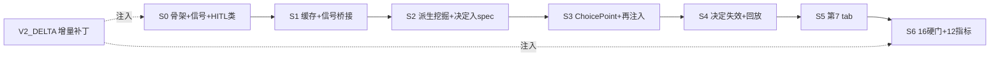

# v2 增量修订：对 S0–S6 计划的逐阶段补丁

> 依据：[`../DESIGN_REFLECTION_V2.md`](../DESIGN_REFLECTION_V2.md)
> **修订原则**：S0–S6 阶段编号不变、既有 126 项测试编号不变、11 个硬门不变；以「增量补丁 + `T-V2-xx` 新编号」方式并入，避免计划失序。
> 累计测试：126 + 24 = **150 项**；硬门：11 + 5 = **16 个**。

---

## 0. 一句话说明本补丁在改什么

v1 是「自动流水线 + 人在两端签字」；v2 是「**确定性派生 + 探索信号 + LLM 提案 + 人类思路**四路输入汇入同一可重算本体」。因此本补丁给每个阶段加两类东西：

1. **探索捕捉**：`KnowledgeSignal` / `SignalCluster` / `MiningCoverage` / `ExplorationFrontier`（复用 `vocab.py::observe/promote` 与 `research/gaps.py::CoverageAnalyzer`）
2. **人类介入**：`ChoicePoint` / `HumanDecision` / `HumanHypothesis` / `MethodAlternative` / `HumanOverride` + `CONSTRAINT_REINJECTION.json`

**不做的**：不给语义层加第 7 类、不改 `vocab.py`/`gaps.py` 行为、不改既有 8 个 miner 的输出、不打乱阶段与测试编号。

---

## 1. 新增 5 个硬门（H12–H16）

| # | 硬门 | 首次生效 | 判据 | 校验命令 |
|---:|---|---|---|---|
| **H12** | 探索信号零丢失 | S0/S1 | 每个词表外 `proposed_new` / `other`、align 未命中、门 FAIL、`MINING_COVERAGE.status=gap`、未采纳的人方向都生成 `KnowledgeSignal`；`signal_capture_rate == 1.0`；`dismiss` 100% 有理由 | `python3 -m capfactory.paperapp.cli audit-signals` |
| **H13** | 人类决定可追溯 | S0 | 每个 `gate` ChoicePoint 有 `HumanDecision` + 6 态 verdict 文件；`DECISION_LOG.jsonl` 只增行；每条带 `approver/ts/evidence_ids` | `python3 -m capfactory.paperapp.cli audit-decisions` |
| **H14** | 人类主权 | S3 | `gate` 超时 → `BLOCKED`，不得自动通过；`human_skip` 有 `APPROVAL_LOG.txt` 记录；**无任何路径能把 LLM 提案晋升进语义层** | `python3 -m capfactory.paperapp.cli audit-sovereignty` |
| **H15** | 决定可传播 | S2/S3 | `CONSTRAINT_REINJECTION.json` 在后续每边界被逐字复述；`spec_hash` 反映当前决定集；`SUPERSEDES` 后受影响阶段标 stale | `python3 -m capfactory.paperapp.cli audit-reinjection` |
| **H16** | 挖掘覆盖率可见 | S2 | `MINING_COVERAGE.json` 存在，`fields/assertions/miners` 三态齐全，`gap_candidates` 每个都连到 `KnowledgeSignal` | `python3 -m capfactory.paperapp.cli mining-coverage` |

> H12–H16 从各自首次生效阶段起，**每阶段验收都要重跑**（与原 H1–H11 的「不退化」规则一致）。

---

## 2. 逐阶段增量补丁

### 2.1 S0 · 骨架（在 [`S0-foundation.md`](S0-foundation.md) 基础上追加）

| 类别 | 增量 |
|---|---|
| 新文件 | `paperapp/signals.py`（`KnowledgeSignal/SignalCluster` 落盘 + `observe_event()` + `cluster()` + `dismiss()`） |
| 新文件 | `paperapp/hitl.py`（`ChoicePoint/HumanDecision/HumanIntent/HumanHypothesis/MethodAlternative/HumanOverride` 六类 + `open_choice()/decide()/supersede()/reinject()`） |
| 新文件 | `paperapp/coverage.py`（只读复用 `research/gaps.py::CoverageAnalyzer`，输出 `MINING_COVERAGE.json`） |
| 修改 | `paperapp/registry.py`：动态类预置从 4 个扩到 10 个（+6 个 HITL/信号类）；**仍走 `register_class()` 正常流程** |
| 修改 | `config.yaml`：`paperapp.signals.promote_after`（默认对齐 `vocab.PROMOTE_AFTER`）、`paperapp.hitl.gate_timeout_policy="BLOCKED"`、`human_boost_cap=0.0`(默认关闭) |
| 修改 | `paperapp_api._V10`：加 `/signals`、`/signals/audit`、`/choices`、`/decisions`、`/reinjection` |
| 修改 | `web/static/paperapp.html`：状态页加「信号数 / 待决 ChoicePoint / 覆盖 gap 数」三个计数卡 |
| 构建 | Step 4 之后插入 4a：`signals.py` 接 `vocab.stats()` 做只读校验；4b：`hitl.py` 六类 + append-only 日志；4c：`coverage.py` 生成首版 `MINING_COVERAGE.json` |
| 修正 | 新增 C13「把 `HumanDecision` 当普通 prompt 文本而非节点」→ 必须有 `decision_id` 与 verdict 文件（T-V2-01）；C14「`gate` 超时被前端自动点了默认项」→ 后端 `BLOCKED` 为准（T-V2-05） |
| 中间结果表新增 | `SIGNAL_LOG.jsonl`、`DECISION_LOG.jsonl`、`MINING_COVERAGE.json`、`CHOICEPOINTS.json` 四行 |
| 新测试 | T-V2-01..04 |
| 验收增补 | H12/H13/H16 首次签字；人工签字项增加「确认 `gate_timeout_policy=BLOCKED`、`human_boost_cap=0.0`」 |

### 2.2 S1 · 缓存（在 [`S1-cache.md`](S1-cache.md) 基础上追加）

| 类别 | 增量 |
|---|---|
| 修改 | `nodecache.py`：`get_or_call()` 的 `cache_identity` **新增 `decision_fp`**（当前有效 `HumanDecision` 集合哈希）→ 人改主意后缓存自然 miss（I5/I2） |
| 修改 | `align.py`：未命中/词表外/冲突时**必须**调 `signals.observe_event()`；`ambiguous_duplicate` 也生成信号 |
| 修改 | `validate.py`：门 FAIL、证据不足、`rejected` 全部生成 `KnowledgeSignal` |
| 修改 | `promote.py`：`kind=class/relation` 的晋升现在要**同时**查 `HumanDecision`（`APPROVES`）而不是只看 `approver` 字符串 |
| 修改 | `schemas.py`：`RequestCacheEntry` 加 `decision_fp`；`LLMNodeProposal` 加 `origin(human|machine|signal)`、`signal_id` |
| 新文件 | `paperapp/signal_bridge.py`：`vocab.observe()` 的 `candidates/promoted` → `KnowledgeSignal` 镜像（补 `stage/paper_id/run_id`） |
| 构建 | Step 6 之后插入 6a：桥接 `vocab.json` 只读消费；6b：信号聚类与 `frequency >= PROMOTE_AFTER` → `VocabPromotion`；6c：`signal → proposal` 通道 |
| 修正 | C15「为了清 pending 把 dismissed 信号删掉」→ 只标 `dismiss_reason`（T-V2-06）；C16「人改主意后仍命中旧缓存」→ `decision_fp`（T-V2-07） |
| 前端增量 | 缓存浏览器 T4 加「信号」子面板：kind 分布、frequency、promoted_to 链接、dismiss_reason |
| 中间结果表新增 | `SIGNAL_LOG.jsonl` 增长、`SignalCluster`、`decision_fp` 变化 |
| 新测试 | T-V2-05..09 |
| 验收增补 | H12 实测 `signal_capture_rate==1.0`；H15 的 `decision_fp` 生效 |

### 2.3 S2 · 前半编排（在 [`S2-pipeline-front.md`](S2-pipeline-front.md) 基础上追加）

| 类别 | 增量 |
|---|---|
| **新 miner** | `miners/flow_closure.py`（D1）、`miners/method_benchmark_matrix.py`（D2）、`miners/lineage_slice.py`（D3）、`miners/capability_cooccurrence.py`（D4）——全部 `NON_LLM`、幂等、只写应用层 |
| 修改 | `applayer/miner.py`：`mine_all()` 增加 `derived_miners=True` 可选参数调用 D1–D4；**默认 False 时既有 8 个 miner 输出逐字节不变**（保护 H11） |
| 修改 | `paperspec.py`：`compile_paperspec()` 输入增加 `decisions`；`compute_hash()` 纳入 `decision_fp`；`PaperSpec` 加 `human_decisions[]`、`mining_coverage{}`、`signals_summary{}` |
| 修改 | `phasegraph.json`：前 11 阶段挂 6 个 ChoicePoint（1b/4broad/2/2.5/3 gate/5 gate），每个带 `mode` 与 `options[]` |
| 修改 | `miners/idea_miner.py`：`HumanHypothesis` 与 `MethodAlternative` 注入 idea DAG 作为额外 root/branch，`origin` 标记，参与同样六轴与 MCTS 4 轮；无 `gap_anchor` 且无 exploratory 理由的**人的方向同样被拒**（P2 不豁免） |
| 修改 | `gates.py`：`ChoicePoint` 的 gate 也产出 6 态 verdict 文件 |
| 修改 | `coverage.py`：D1–D4 运行后刷新 `MINING_COVERAGE.json`，`gap_candidates` 逐个生成信号 |
| 构建 | Step 7 之后插入 7a–7d 四个派生 miner；Step 3 之后插入 3a `decision_fp` |
| 修正 | C17「人的方向绕过 gap_anchor」→ 统一校验（T-V2-11）；C18「`human_boost` 让人选必胜」→ 默认 0、上限可配、留痕（T-V2-12）；C19「D1 中文词元被拆单字」→ 复用 `_as_list` 思路（T-V2-10） |
| 前端增量 | T2 编排页加「派生视图」区（D1–D4 各产出数）、「覆盖率」进度条、「人类思路注入」入口 |
| 中间结果表新增 | `MINING_COVERAGE.json`、D1–D4 产物、`HumanHypothesis` 分支、`spec_hash` 含 decision_fp |
| 新测试 | T-V2-10..14 |
| 验收增补 | H16 签字；H15 首次签字；H6 改为「同一决定集下 spec 幂等，决定变化则 hash 变化」 |

### 2.4 S3 · 后半编排（在 [`S3-pipeline-back.md`](S3-pipeline-back.md) 基础上追加）

| 类别 | 增量 |
|---|---|
| 修改 | `phasegraph.json`：后 15 阶段挂 8 个 ChoicePoint（6/6b gate/10/11/12/14 gate/15.5 + 4targeted advisory） |
| 修改 | `runner.py`：每边界执行 `reinject()`——逐字复述 `CONSTRAINT_REINJECTION.json` 并把摘要写进 `events.ndjson`；`gate` 超时 → `BLOCKED` + verdict 文件 |
| 修改 | `loopback.py`：`SUPERSEDES` 作为一种新的「有预算回退」登记（L14，预算 ≤2，与 BA 分开计） |
| 修改 | `stages/s10_claims.py`：人可 `option` 调整 claim 强度与阴性结果去向，但**不得超过证据 fidelity** |
| 修改 | `stages/s14_review.py`：kill argument 是否成立是 `gate`；`human_skip` 需 `APPROVAL_LOG.txt` |
| 修改 | `budget.py`：新增 `exploration_regret` 护栏（连续 3 run 无新 `ExplorationFrontier` 且预算 <50% → WARN） |
| 新文件 | `paperapp/reinjection.py`：生成/校验 `CONSTRAINT_REINJECTION.json`，提供 `verbatim_for(stage)` |
| 修改 | `LESSONS.json` schema：新增第 5 类 `human_hypothesis_rollbacks`（带 evidence + lesson） |
| 构建 | Step 4 之后插入 4a 约束再注入；Step 10 之后插入 10a gate 超时演练；Step 11 之后插入 11a 第 5 类 lesson |
| 修正 | C20「gate 超时前端自动通过」→ 后端 BLOCKED（T-V2-15）；C21「人方向失败被静默丢弃」→ 写第 5 类 lesson（T-V2-16）；C22「约束只注入一次就忘」→ 每边界逐字复述（T-V2-17） |
| 前端增量 | T3 运行页每卡片显示「本阶段受哪些 HumanDecision 约束」；事件流新增 `reinjection` 事件类型 |
| 中间结果表新增 | `CONSTRAINT_REINJECTION.json`、`LESSONS[4]`、`exploration_regret`、L14 记录 |
| 新测试 | T-V2-15..18 |
| 验收增补 | H14/H15 签字；人工签字项增加「确认 gate 超时为 BLOCKED、确认 KILL 有 APPROVAL_LOG」 |

### 2.5 S4 · 增量回写（在 [`S4-materialize.md`](S4-materialize.md) 基础上追加）

| 类别 | 增量 |
|---|---|
| 修改 | `verify_rebuild()`：重算输入现在是 `f(semantic, rules, decisions)`；`decision_fp` 变化必须重算 |
| 修改 | `dependency_index.py`：新增 `decision_id → 受影响应用节点` 反向键；`SUPERSEDES` 触发最小重算 |
| 修改 | `replay.py`：`REPLAY_CONTEXT.json` 消费 `human_hypothesis_rollbacks` → `avoid` 或 `exploration_seed`；`ExplorationFrontier.status` 可 `untried` 重启 |
| 修改 | `materialize.py`：信号聚类晋升（`SignalCluster.frequency` 达阈 → `ClassRegistrationProposal`，仍需人批准）；`HumanDecision` 相关节点同样带 `origin` 与 `decision_id` |
| 修改 | `MATERIALIZE_REPORT.json`：新增 `n_signals_captured / n_decisions_applied / decision_fp / exploration_regret` |
| 构建 | Step 2 之后插入 2a decision 反查索引；Step 8 之后插入 8a 信号晋升通道 |
| 修正 | C23「人改主意后 delta 用的是旧决定」→ `verify_rebuild` 校验 `decision_fp`（T-V2-19）；C24「失败的人方向被当成 avoid 永远不再试」→ 允许 `untried` 重启且需理由（T-V2-20） |
| 前端增量 | T5 回写页加「决定影响范围」与「信号晋升」两块 |
| 新测试 | T-V2-19..21 |
| 验收增补 | H12/H13/H15 不退化；`stale_recompute_scope` 现在也要覆盖 decision 变更 |

### 2.6 S5 · 前端（在 [`S5-frontend.md`](S5-frontend.md) 基础上追加）

| 类别 | 增量 |
|---|---|
| **新增第 7 tab** | T7「人工决策」：待办 ChoicePoint（`gate>option>advisory` 排序）、选项卡对比、方向输入、方法尝试、决策历史、约束再注入视图、失败反思 |
| 修改 | `paperapp.html`：6 tab → 7 tab；`paperapp.js` 抽 `renderChoiceCard()` / `renderDecisionHistory()`；`paperapp.css` 加 `.gate/.advisory/.superseded` 三态样式 |
| 修改 | `paperapp_api.py`：新增 `/choices/{id}`、`/decisions/{id}`、`/hypotheses`、`/frontiers`、`/reinjection`；`/overview` 加 `pending_gate_choices / n_signals / n_frontiers` |
| 修改 | `paperapp_overview.py`：聚合 `audit-signals/audit-decisions/mining-coverage` 三个摘要 |
| 修改 | T1 总览加「信号数 / 待决 gate / 覆盖 gap」三卡；T2 加派生视图与覆盖率；T3 加约束来源；T4 加信号子面板；T5 加决定影响范围 |
| 修改 | `smoke.sh` 追加 3 项（`/choices`、`/decisions`、`/mining-coverage`） |
| 修正 | C25「`gate` 超时前端显示『已自动通过』」→ 禁止该文案，只显示 BLOCKED + 原因（T-V2-22）；C26「方向输入缺 falsifiable_claim 也能提交」→ 表单必填校验（T-V2-22） |
| 新测试 | T-V2-22..23 |
| 验收增补 | H13/H14 前端侧；7 tab 零 console error；`gate` 红色排序在最前 |

### 2.7 S6 · 修正与回归（在 [`S6-hardening.md`](S6-hardening.md) 基础上追加）

| 类别 | 增量 |
|---|---|
| 修正闭环 | `FIX_CLOSURE.json` 从 64 条扩到 **90 条**（+26 条 v2 新增 C 项） |
| 新增演练 | F9「人中途改主意」→ `SUPERSEDES` + 最小重算；F10「gate 超时」→ BLOCKED；F11「词表外新概念连续出现 3 次」→ 扩表 + 提案 + 人批准；F12「人方向失败」→ 第 5 类 lesson + frontier 重启 |
| 新增指标 | `signal_capture_rate`、`exploration_regret`、`decision_propagation_rate`、`mining_coverage_ratio` 四项 |
| 修改 | `report.py`：8 项指标 → **12 项**；`INTEGRATION_REPORT.md` 增加「人类介入与探索」章节 |
| 修改 | `scripts/test_all.sh`：追加 `audit-signals / audit-decisions / audit-sovereignty / audit-reinjection / mining-coverage` |
| 修改 | 11 硬门签字表 → **16 硬门**；8 指标表 → 12 指标表 |
| 新测试 | T-V2-24（v2 全套硬门与指标填入报告） |
| 验收增补 | 累计 150 项测试；H12–H16 全部签字 |

---

## 3. 新增测试 `T-V2-01..24`

| 编号 | 阶段 | 类型 | 断言 | 覆盖硬门 |
|---|---|---|---|---|
| T-V2-01 | S0 | 单元 | `HumanDecision` 是节点（有 `decision_id` + verdict 文件），不是纯文本 | H13 |
| T-V2-02 | S0 | 单元 | 6 个新本体类全部注册且 `status=active` | — |
| T-V2-03 | S0 | 单元 | `gate_timeout_policy` 从 config 读，代码无硬编码 | H14 |
| T-V2-04 | S0 | 集成 | `MINING_COVERAGE.json` 三态齐全且 gap 连到信号 | H16 |
| T-V2-05 | S0/S1 | 单元 | `gate` 超时后端返回 `BLOCKED`，前端无法自动通过 | H14 |
| T-V2-06 | S1 | 单元 | dismissed 信号仍存在且有 `dismiss_reason` | H12 |
| T-V2-07 | S1 | 集成 | `decision_fp` 变化 → `request_key` miss（不复用旧 LLM 输出） | H15/I2 |
| T-V2-08 | S1 | 集成 | `vocab.candidates` 每项镜像成 `KnowledgeSignal`（补 stage/paper/run） | H12 |
| T-V2-09 | S1 | 单元 | `signal_capture_rate == 1.0`（5 类事件全覆盖） | H12 |
| T-V2-10 | S2 | 单元 | D1 中文词元不拆单字、环被标 `CyclicFeedback` | — |
| T-V2-11 | S2 | 集成 | 人的方向无 `gap_anchor` 且无 exploratory 理由 → 同样被拒 | P2/I4 |
| T-V2-12 | S2 | 单元 | `human_boost` 默认 0、有上限、可在 config 关闭 | I4 |
| T-V2-13 | S2 | 集成 | `spec_hash` 随 `HumanDecision` 变化而变化（可重算） | H15/I2 |
| T-V2-14 | S2 | 集成 | D1–D4 默认关闭时既有 8 miner 输出逐字节不变 | H11/I7 |
| T-V2-15 | S3 | 集成 | gate 超时 → BLOCKED + verdict 文件；`human_skip` 有 APPROVAL_LOG | H14 |
| T-V2-16 | S3 | 集成 | 人方向失败写入 `LESSONS.human_hypothesis_rollbacks` | I3 |
| T-V2-17 | S3 | 集成 | `CONSTRAINT_REINJECTION` 在后续每边界逐字复述（事件可查） | H15 |
| T-V2-18 | S3 | 单元 | `exploration_regret` 护栏触发 WARN | I3 |
| T-V2-19 | S4 | 集成 | `SUPERSEDES` 后 `verify_rebuild` 用新 `decision_fp` 重算 | I2/I5 |
| T-V2-20 | S4 | 单元 | 失败 frontier 可 `untried` 重启且需理由，不永久 avoid | I3 |
| T-V2-21 | S4 | 集成 | `decision_id → 节点` 反查命中，`stale_recompute_scope < 5%` | H15 |
| T-V2-22 | S5 | 前端 | gate 待办排最前、无「自动通过」文案；方向表单必填 `falsifiable_claim` | H14 |
| T-V2-23 | S5 | API | 5 个新端点 200/空态正确；`/overview` 含 3 个新计数 | H9 |
| T-V2-24 | S6 | 签字 | 16 硬门 + 12 指标实测值填满 `S6_FINAL_REPORT.md` | 全部 |

**夹具追加**：`tests/fixtures/paperapp_v2/` —— 3 个词表外概念、2 个 ChoicePoint（含 1 个超时）、1 个 `HumanHypothesis`、1 个 `SUPERSEDES`、1 个失败 frontier。

---

## 4. 新增 4 项验收指标（与 v1 的 8 项并列，共 12 项）

| 指标 | 目标 | 采集处 |
|---|---|---|
| `signal_capture_rate` | **= 1.0（硬门 H12）** | `audit-signals` |
| `decision_propagation_rate` | **= 1.0**（每个 gate 决定在后续每边界被复述） | `audit-reinjection` |
| `mining_coverage_ratio` | ≥ 0.75（v4.1 全部字段/关系被至少一个 miner 或派生视图消费） | `MINING_COVERAGE.json` |
| `exploration_regret` | 0（连续 3 run 无新 frontier 且预算 <50% 即 WARN） | `RUN_BUDGET.json` |

另两个观察指标（不设阈值，异常即审计）：`signal_to_proposal_rate`、`human_hypothesis_survival_rate`（人方向通过 MCTS 的比例，过低说明人的方向被系统性压制，过高说明 boost 过强）。

---

## 5. 新增故障注入演练 F9–F12（S6）

| # | 注入 | 期望 | 恢复 |
|---:|---|---|---|
| F9 | run 中途人改主意（`SUPERSEDES`） | 旧决定标 `valid_to`；`decision_fp` 变；缓存 miss；`dependency_index` 只标受影响节点；`verify_rebuild` 用新决定集通过 | 恢复原决定并记录 |
| F10 | `gate` ChoicePoint 超时 | 后端 `BLOCKED` + verdict 文件；前端不出现「自动通过」；`human_skip` 需 APPROVAL_LOG | 人工补决定 |
| F11 | 同一词表外概念连续出现 3 次 | `observe()` 计数 → `promote()` 扩表 → `KnowledgeSignal` 聚类 → 生成提案 → **新类仍需人批准** | 标 `valid_to` 归档 |
| F12 | 人提出的方向在 6b 失败 | 写 `LESSONS.human_hypothesis_rollbacks`；frontier=`failed`；下轮 `REPLAY_CONTEXT` 有 `avoid` 且可 `untried` 重启 | 恢复 frontier 状态 |

---

## 6. 第 7 个前端 tab 的详细契约（S5 增补）

| 路径 | 方法 | 200 | 错误 |
|---|---|---|---|
| `/api/v10/paperapp/choices?status=pending&mode=gate` | GET | `{items:[{choice_id, stage, mode, options[], default_option, deadline}], count}` | — |
| `/api/v10/paperapp/choices/{id}` | POST | `{ok, decision_id, chosen_option_id, reinjection_updated}` | gate 超时 → 409 `choice_timeout_blocked`；缺 approver → 403 |
| `/api/v10/paperapp/hypotheses` | POST | `{ok, hypothesis_id, dag_branch_id}` | 缺 `falsifiable_claim` / `gap_anchor` → 400 |
| `/api/v10/paperapp/decisions?limit=` | GET | `{items:[...], count, append_only:true}` | — |
| `/api/v10/paperapp/reinjection` | GET | `{decisions:[{verbatim_text, applies_to_stages}], spec_hash_input:true}` | — |
| `/api/v10/paperapp/frontiers` | GET | `{items:[{direction,status,source,tried_in[]}]}` | — |
| `/api/v10/paperapp/mining-coverage` | GET | `MINING_COVERAGE.json` | 未生成 → 404 |

**UI 红线**：`gate` 卡片红色且排最前；超时只显示 `BLOCKED`；「方向输入」必填 `statement / falsifiable_claim / gap_anchor(或 exploratory 理由)`；决策历史中被 `SUPERSEDES` 的旧决定灰显带 `valid_to`；不存在任何「把提案晋升进语义层」的按钮。

---

## 7. 修订后的依赖与进度

**进度看板追加**（`plan/README.md` §7）：
- [ ] v2 补丁 S0（H12/H13/H16 首签）
- [ ] v2 补丁 S1（`decision_fp` / 信号桥接）
- [ ] v2 补丁 S2（D1–D4 / 覆盖率 / 人方向入 DAG）
- [ ] v2 补丁 S3（14 ChoicePoint / 再注入 / 第 5 类 lesson）
- [ ] v2 补丁 S4（SUPERSEDES 最小重算）
- [ ] v2 补丁 S5（第 7 tab）
- [ ] v2 补丁 S6（F9–F12 / 16 硬门 / 12 指标 / 150 项测试）

---

## 8. 需要同步修改的既有段落（本补丁的落地清单）

| 文件 | 段落 | 动作 |
|---|---|---|
| [`plan/README.md`](README.md) | §2 阶段总表、§5 硬门表、§7 进度看板、§8 风险表、§9 索引 | 追加 v2 小节与 H12–H16、7 tab、V2_DELTA 链接 |
| [`plan/TEST_PLAN.md`](TEST_PLAN.md) | §2 编号总表、§3 夹具、§4 门禁、§6 覆盖率、§8 映射 | 追加 `T-V2-01..24`、`fixtures/paperapp_v2`、150 项、16 硬门映射 |
| `docs/SCIFORGE_INTEGRATION_BLUEPRINT.md` | §4 架构、§4.1 写入权限矩阵、§10 复用清单、§12 指标 | 以 v2 文档为准，追加指针（**不重写**） |
| `docs/DYNAMIC_ONTOLOGY_NODE_CACHE.md` | §3.1 cache_identity、§7 失效、§9 接入点 | 追加 `decision_fp` 与 decision 反查索引指针 |
| `src/capfactory/config.yaml` | `paperapp:` | 新增 `signals` / `hitl` 两段 |
| `src/capfactory/web/server.py` | `WEB_API_MODULES` | 不变（仍只有 `paperapp_api`），新增端点都在 `_V10` 内 |

---

## 9. v2 验收签字增补（S6 §7）

| 门 | 判据 | 实测 |
|---|---|---|
| H12 信号零丢失 | `signal_capture_rate == 1.0`；dismiss 100% 有理由 | `______` |
| H13 决定可追溯 | 每个 gate 有 `HumanDecision` + verdict；`DECISION_LOG` 只增行 | `______` |
| H14 人类主权 | gate 超时 BLOCKED；无路径把 LLM 提案写进语义层 | `______` |
| H15 决定可传播 | `decision_propagation_rate == 1.0`；`spec_hash` 反映决定集 | `______` |
| H16 覆盖率可见 | `MINING_COVERAGE.json` 三态齐全，`mining_coverage_ratio ≥ 0.75` | `______` |
| 累计测试 | **150 项**全过 | `____/____` |
| 累计指标 | **12 项**填满 | `____/____` |

**人工签字项增补**：确认语义层仍是 6 类；确认 `vocab.py` / `research/gaps.py` / `applayer/miner.py` 的既有行为未被修改；确认 `human_boost_cap=0.0` 或已记录上调理由；确认所有被拒/被 supersede 的信号与决定都仍可查询。
