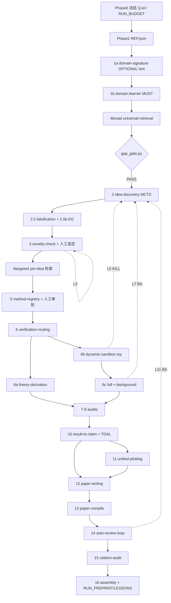

# 生成论文时应调用的完整应用层本体框架

**GGR-Paper Application Ontology v1.0**

> 来源：`SciForge-OSS-master/skills/meta-skills/` 8 个 SKILL.md（1896 行）+ `scripts/` 33 个判定脚本 + `orchestrator/auto-pipeline/SKILL.md`（575 行，26 节点 DAG）。
> 目标：把这套「散文契约 + 机械门 + 编排器」抽象成**可被语义层驱动的应用层本体**，用于「分子算法设计」方向自动生成论文时按阶段调用。
> 输出位置：`/home/zengshuxin/molecular_algrithem_design/docs/skills/APPLICATION_ONTOLOGY_FRAMEWORK.md`（与 8 篇逐篇解析同目录；若需放到 `docs/` 根目录可整体移动，索引链接见 `README.md`）。
> 逐篇依据：[README.md](README.md) 中 8 篇文档的 §6「关键知识节点」与 §7「对应 scripts 代码」。

---

## 0. 结论摘要

SciForge-OSS 不是「8 个工具」，而是**一个由文件产物串联的三层系统**：

| 层 | 载体 | 职责 | 是否做主观判断 |
|---|---|---|---|
| **契约层** | `skills/meta-skills/*.md`（8 个） | 规定每个阶段产出什么文件、字段、判定口径 | 是（LLM 执行） |
| **机械判定层** | `scripts/*.py`（33 个） | 正则 / AST / 公式 / 哈希 / exit code | **否** |
| **编排层** | `skills/orchestrator/auto-pipeline/SKILL.md` | 读 verdict → 套质量门 → 触发回退 → 冻结检查点 | 否（结构性） |

**一句话本体**：`Phase` 消费 `Artifact`、产出 `Artifact`、由 `Gate` 裁决、由 `Verdict` 记录、由 `LoopBack` 回退；所有 `Artifact` 都挂在冻结的 `ProblemAnchor`(Q-id) 上，并通过 `Anchor`/`Hash` 与证据字节绑定。

因此「生成论文时应该调用什么」的答案是：**按 26 节点 DAG 依次调用 8 个 meta-skill + 20 个 support skill，每跨一个边界跑对应的 scripts gate，用 6 态 verdict 推进或回退**。完整表见 §3，可执行顺序见 §7。

---

## 1. 八条元设计原则（从 8 个 skill 归纳，是框架的不变量）

| # | 原则 | 来源 | 本体约束 |
|---|---|---|---|
| P1 | **单一写入者** | `domain-learner` 独占 `domain-signature.json`；`references.bib` 全 wave 累积不 fork；`FIGURE_AUDITS.json` upsert | `SingleWriter(Artifact) = 1` |
| P2 | **文献先于 idea** | `universal-retrieval` v6.0 wave protocol；`gap_gate.py` 硬门 | `IdeaScoring ⇒ GAP_REPORT.readable` |
| P3 | **机械判定先于 LLM 判断** | `idea-discovery` Type-A/B 解耦；orchestrator "deterministic-first" | `TypeB(Idea) ⇒ TypeA(Idea).PASS` |
| P4 | **一切锚定留痕** | `gap_anchor` / `claim_anchor` / INV-G1 / triple hash | 每个 `Claim`/`Idea` 必须有 `ANCHORS` 边 |
| P5 | **判定靠 exit code，不靠散文** | "Mechanical verdicts via tool, not prose"；`sciforge_audit.py` 一次硬退出码 | `Gate ⇒ MachineVerdict` |
| P6 | **降级不等于跳过** | 网络问题只能 PASS→WARN；OPTIONAL 失败记 WARN 继续；`NOT_APPLICABLE` 需在 `na_verdicts` 声明 | `WARN ≠ SKIP ≠ BLOCKED` |
| P7 | **可复现 = 源码 + 输入 + 哈希** | `dynamic-sandbox`、`dynamic-tooling`、`unified-plotting` 三者一致 | `Result ⇒ Source ∧ Input ∧ sha256` |
| P8 | **回退带预算且必须改状态** | 3 轮 fallback / BA 全局 ≤2 轮 / Loop-Back Registry L1–L13 | `LoopBack ⇒ budget ∧ state_change` |

反例（这些正是框架要阻止的）：为了美观删掉真实数据特征；用 demo 实验顶替 toy gate；给跨论文模块补假边；把引用标题当逐字引文；caption 先于渲染写；网络不通就跳过文献检索。

---

## 2. 三层架构与「四层模块」的投射

```
                          ┌──────────────────────────────────┐
                          │  编排层 Orchestration (26 nodes)  │
                          │  auto-pipeline / RUNSTATE / budget│
                          └──────────────┬───────────────────┘
                                         │ 读 verdict / 套质量门
        ┌────────────────────────────────┼────────────────────────────────┐
        │                                │                                │
┌───────▼────────┐            ┌──────────▼──────────┐          ┌─────────▼─────────┐
│ 契约层 (8 meta) │  写产物 →  │  机械判定层 (33 scripts)│  ←读  │  文件产物 Artifacts│
│ domain-* / idea │───────────▶│ gap/doi/dep/smoke/…    │───────│ .bib/.json/.md/.pdf│
│ novelty / retr. │            │ exit 0 PASS | 2 FAIL   │       │ + 哈希 + MANIFEST  │
│ tooling/sandbox │◀───────────│ (render_figure: 4 FAIL) │       │                    │
│ plotting        │  机器裁决   └─────────────────────────┘       └────────────────────┘
└─────────────────┘
```

### 2.1 论文 / 算法 / 代码 / 数据 四层模块投射

| 模块层 | 承载的本体类 | 主要 skill | 主要 scripts | 关键产物 |
|---|---|---|---|---|
| **论文层** | `PaperSection`, `Caption`, `FrontierBaseline`, `DeltaClaim`, `FigureBudget`, `CitationArtifact`, `Claim` | `domain-learner`(writing_profile)、`novelty-check`(Intro 三元组)、`universal-retrieval`(bib)、`unified-plotting`(图预算) | `doi_gate`, `citation_support`, `figure_style_gate`, `check_figure_embedding`, `leakage_scan` | `main.tex`, `references.bib`, `FRONTIER_GAP.md`, `FIGURE_INDEX.md` |
| **算法层** | `IdeaNode`, `IdeaDAG`, `MethodRegistry`, `Assumption`, `DerivationStep`, `FrontierNode`, `CollisionMatrix` | `idea-discovery`, `novelty-check`, `dynamic-tooling`(symbolic-reasoner / formal-verifier) | `gap_gate`, `s2_ladder_gate`, `s2_ablation_gate`, `arb_verify`, `fantasy_gate` | `IDEA_DAG.json`, `FINAL_PROPOSAL.md`, `METHOD_REGISTRY.md`, `PROOF_AUDIT.json` |
| **代码层** | `Tool`, `ToolTemplate`, `ToolContract`, `SandboxCode`, `DeviceProfile`, `SecurityFinding`, `SmokeEvidence`, `DependencyRoot`, `FigureSpec`, `Renderer` | `dynamic-tooling`, `dynamic-sandbox`, `unified-plotting` | `dep_gate`, `detect_device`, `security_scan`, `smoke_gate`, `render_figure`, `figure_audit` | `tools/registry.json`, `sandbox/session_*`, `figures/<name>/render.py`, `figure_audit.json` |
| **数据层** | `InputData`, `OutputData`, `Benchmark`, `ExperimentNode`, `Result`, `DataProfile`, `EvidenceNormProfile`, `VerifiedPaper` | `domain-learner`(evidence_norm)、`universal-retrieval`(verified_papers)、`dynamic-sandbox` | `tdal_compute`, `s2_audit`, `s2_integrity_gate`, `claim_anchor_gate`, `workspace_hygiene` | `input.json`, `output.json`, `RESULT.json`, `verified_papers.json`, `TDAL.json` |
| **治理层（横切）** | `ProblemAnchor`, `Verdict`, `Gate`, `LoopBack`, `RunBudget`, `ArtifactRegistry`, `ClaimAnchor`, `Hash` | orchestrator（非 meta-skill） | `sciforge_audit`, `validate_verdicts`, `completion_gate`, `submission_ready` | `RUNSTATE.json`, `PIPELINE_VERDICT_SUMMARY.md`, `RUN_BUDGET.json`, `LESSONS.json` |

---

## 3. 阶段 — skill — 脚本 全表（26 节点 DAG，v1.7.2）

| Phase | 模式 | 调用对象 | 读（关键产物） | 写（关键产物） | 门 / 脚本 |
|---|---|---|---|---|---|
| 0 | MUST | orchestrator | 用户给的 Q-id | `RUN_BUDGET.json`, Q-id 冻结 | INV-G1；Q-id 不明确 → 问人 |
| 1 | MUST | orchestrator | problem | `REP.json`（分阶段目标 + fallback 条件） | `rep_plan_present` |
| 1a | OPTIONAL | **`domain-signature`** | 问题文本 | `domain-signature-hint.json` | 无硬门；失败 WARN |
| 1b | **MUST** | **`domain-learner`** | hint(prior) + 文献 + 3–5 seed papers | **`domain-signature.json`**（唯一写入者） | `learning_confidence ≥ 0.7`；`tdal_compute.py` A 维 |
| 4broad | **MUST** | **`universal-retrieval`** broad wave | 6 源检索 | `references.bib`, `landscape_report.md`, **`GAP_REPORT.md`** | **`gap_gate.py`**（gap-id/引用/判别动词/effort 门槛） |
| 2 | MUST | **`idea-discovery`** | Q-id, signature, bib, **`GAP_REPORT.md`**, `RUN_PREPRINT.md`, `LESSONS.json`, `failed_ideas.json` | `IDEA_CANDIDATES.md`, `IDEA_DAG.json`, `IDEA_DAG_VISUAL.md`, `MCTS_LOG.md`, `GAP_ANCHOR_LOG.md`, `FINAL_PROPOSAL.md` | Type-A(`dep_gate`/`detect_device`/`security_scan`)、TF-IDF>0.78 硬拒、6 轴 BLOCKED、≥4 轮 MCTS；`gap_gate` 前置 |
| 2.5 | MUST | `/adversarial-falsification`（support） | signature 的 failure modes | `FALSIFICATION_RECORD.json` | 假设健康 ≥6 或无反例；`fantasy_gate.py` Gate4 |
| 2.5b | MUST | Engineering Grounding | `IDEA_DAG.json` | `ENGINEERING_GROUNDING.md` | ≥3 子维=0 → BLOCKED |
| 3 | **MUST + 人工** | **`novelty-check`** | DAG, `FRONTIER_MAP`, `TARGETED_WAVE_LOG`, `GAP_ANCHOR_LOG` | `novelty_report.json`, `survivor.md`, `FRONTIER_GAP.md`, `FRONTIER_MAP.json`, `differentiation.md`, `collision_matrix` | 复合分 ≥0.6、至多 1 survivor；`doi_gate`/`fantasy_gate`/`claim_anchor_gate`；**Phase 3→4 强制人择** |
| 4targeted | MUST | **`universal-retrieval`** targeted waves | 每个存活 idea 的 gap + 关键词 | `TARGETED_WAVE_LOG.md`（append-only），bib 追加 | 碰撞预检；`citation_support.py` |
| 5 | **MUST + 人工** | `/method-registry` | `FINAL_PROPOSAL.md` | `METHOD_REGISTRY.md`, `EXPERIMENT_MATRIX.json`, Section 3 hash lock | **Phase 5→6 强制人批**；hash mismatch → 重建（L4, 3 轮） |
| 6 | MUST | `/verification-routing` | signature | `VERIFICATION_ROUTING.json` | experiment-first / theory-only / hybrid；声明 `na_verdicts` |
| 6a | ROUTED | `/theory-derivation` + **`dynamic-tooling`**(symbolic-reasoner) | 假设集 | `PROOF_AUDIT.json`, `derivations/*.md` | SymPy 逐步验证；`arb_verify.py`(可选) |
| 6b | ROUTED | **`dynamic-sandbox`**(toy) | `DEVICE.json`, `input.json` | `RESULT.json`, `.SMOKE.json` | `security_scan.py` 先扫 → `smoke_gate.py`；FAIL → KILL-or-PIVOT |
| 6c | ROUTED | `/experiment-execution`(full+bg) + sandbox | 实验矩阵 | `DISPATCH.json`, `STATUS.json`, `S2_LADDER.json` | `s2_ladder_gate.py`, `s2_integrity_gate.py`, `budget_floor` |
| 7–9 | MUST | `/leakage-audit`, `/logic-verification`, `/invariant-check` | 推导 + 实验结果 | `LEAKAGE_AUDIT.md`, `LOGIC_VERIFICATION.json` | `leakage_scan.py`；INV-G1 内容哈希；FATAL → BA |
| 10 | MUST | `/result-to-claim` + `/ablation-planner` | 全部 verdict | `CLAIMS_FROM_RESULTS.md`, `CLAIM_ANCHORS.json`, `TDAL.json`, `ABLATION_LEDGER.json` | `tdal_compute.py`(T×D×A×L)、`s2_ablation_gate.py`、`claim_anchor_gate.py`、`fantasy_gate.py` |
| 11 | **MUST** | **`unified-plotting`** | `RESULT.json` → `input_data.json`, Q-id | `output.pdf+svg`, `figure_audit.json`, `latex_include.tex`, `FIGURE_AUDITS.json` | `render_figure.py --strict`(FAIL=4)、`figure_audit.py` A1–A11、`figure_style_gate.py`、`check_figure_embedding.py` |
| 12 | MUST | `/paper-writing` | `FRONTIER_GAP.md`(Intro), figure budget, `latex_include.tex` | `paper/main.tex`, `PAPER_PLAN.md` | `citation_support.py`, `leakage_scan.py`(Class A–J)、caption 纪律 |
| 13 | MUST | `/paper-compile` | main.tex + figures | `main.pdf`, `compile.log` | 零 error / 零 warning；`check_figure_embedding.py` 拒编译 |
| 14 | MUST | `/auto-review-loop`, `/kill-argument` | 全稿 | `REVIEW_STATE.json`, `REBUTTAL_PLAN.json`, `KILL_ARGUMENT.json` | score ≥6（<8 触发 rebuttal）；`s2_*` 校准；kill 有人工检查点 |
| 15 | MUST | `/citation-audit` | bib + 正文 | `CITATION_AUDIT.json` | `doi_gate.py`（strict DOI + 标题 token-overlap ≥0.8）、`citation_support.py` |
| 15.5 | MUST | `/publishability-score` | 全 verdict | `PUBLISHABILITY.json` | `fairness_gate.py`，主实验逻辑轴 |
| 16 | MUST | orchestrator | 全部 | `RUN_PREPRINT.md`, `LESSONS.json`, `output/` | `validate_verdicts.py --strict --require-complete`、`completion_gate.py`、`workspace_hygiene.py`、`submission_ready.py`、`s2_audit.py` |

---

## 4. 应用层本体：类清单（5 个命名空间）

> 记法：`类(关键属性)` → `RELATION → 目标`。属性省略通用字段（`id`, `created_at`, `provenance`）。

### 4.1 治理层 Governance

| 类 | 关键属性 | 主要关系 |
|---|---|---|
| `ProblemAnchor` | `q_id`, `content_hash`, `frozen_at` | `ROOT_OF → IdeaDAG`；`REFERENCED_BY → 所有 Artifact`（INV-G1） |
| `Phase` | `phase_no`, `mode(MUST/OPTIONAL/ROUTED)`, `gate_condition` | `INVOKES → Skill`；`GATED_BY → Gate` |
| `Skill` | `name`, `version`, `type`, `role`, `stage` | `PRODUCES/CONSUMES → Artifact` |
| `Gate` | `script`, `exit_code_map`, `threshold` | `EMITS → Verdict` |
| `Verdict` | `state(6态)`, `reason_code`, `evidence[]` | `BLOCKS/ADVANCES → Phase` |
| `LoopBack` | `trigger`, `target_phase`, `budget`, `exhaustion_exit` | `REQUIRES → state_change` |
| `RunBudget` | `wall_clock_seconds`, `api_cost_usd`, `pivot_count`, `ba_rounds_used` | `CAPS → LoopBack` |
| `ArtifactRegistry` | `single_writer`, `schema_path`, `hash_lock` | `INDEXES → Artifact` |
| `ClaimAnchor` | `code_sha`, `inputs_sha`, `outputs_sha`, `resolved` | `BINDS → Claim ↔ Result` |
| `Hash` | `algo=sha256`, `value`, `of_bytes` | `CERTIFIES → Source/Input/Output` |

### 4.2 文献与选题层 Literature & Ideation

| 类 | 关键属性 | 主要关系 |
|---|---|---|
| `DomainSignatureHint` | `signature_id`, `confidence{}` | `IS_PRIOR_FOR →` `DomainProfile` |
| `DomainProfile` | `primary_domain`, `evidence_type`, `reasoning_paradigm`, `learning_confidence` | `WEIGHTS →` 4 视角；`SELECTS → VerificationRoute`；`PRODUCED_BY → domain-learner` |
| `EvidenceNormProfile` | `sample_size_norm`, `control_design_norm`, `effect_reporting_norm`, `negative_result_norm`, `exemplar_venues` | `CALIBRATES → ClaimConfidence`；`SIZES → ExperimentMatrix` |
| `DataSource` | `priority(1–6)`, `coverage` | `RETURNS → CandidatePaper` |
| `CandidatePaper` | `arxiv_id`, `doi`, `title`, `authors`, `year` | `VERIFIED_BY → VerificationLayer` |
| `VerificationLayer` | `layer_no(1–3)`, `status`, `fuzzy_score` | `AGGREGATES_TO → CitationVerdict` |
| `VerifiedPaper` | `cite_key`, `layers[]`, `recency_ratio` | `CITED_BY → Gap / PaperSection` |
| **`Gap`** | `gap_id`, `gap_type(5枚举)`, `statement`, `evidence[]`, `priority` | **`ANCHORS → IdeaNode`**；`SUPPORTED_BY → VerifiedPaper`；`CONSISTENT_WITH → LandscapeReport` |
| `FrontierNode` | `paper_key`, `year`, `claims[]`, `open_problems[]`, `state(solved/unsolved)` | `CROSS_LINKS → Gap` |
| `FrontierBaseline` / `DeltaClaim` / `WhyNotBefore` | SOTA 列表 / falsifiable 增量 / 3 类原因 | 三元组 `SHAPES → PaperSection(Introduction)` |
| `CollisionMatrix` | `same_problem`, `same_method`, `same_data` | `VERDICTS → IdeaNode`(fatal/high/medium/low) |
| `IdeaNode` | `id`, `perspective(4)`, `6-axis scores`, `insight`, `novelty_delta`, `falsifiable_claim`, `mechanism`, `boundary`, `gap_anchor`, `eg_average` | `DEPENDS_ON → IdeaNode`(无环)；`PROMOTED_TO → FinalProposal` |
| `TypeASpec` | `requires_gpu_gb`, `requires_packages[]`, `data_sources[]`, `code_snippet` | `GATES → IdeaNode`（零 LLM） |
| `MCTSRound` | `round_no`, `promotions[]`, `rejections[]`, `children[]` | `REFINES → IdeaNode` |
| `FailedIdea` / `BAEvent` | 失败原因 / 触发条件，失败证据 | `EXCLUDES → IdeaRegeneration`；`TRIGGERS → LoopBack(BA)` |
| `Survivor` / `FinalProposal` | 复合分 / `problem_anchor`, `rejected_alternatives[]`, `mcts_evidence` | `CONSUMED_BY → MethodRegistry` |

### 4.3 方法与证据层 Method & Evidence

| 类 | 关键属性 | 主要关系 |
|---|---|---|
| `MethodRegistry` | 8 节结构, `section3_hash`, `experiment_matrix` | `BINDS → IdeaNode`；`HASH_LOCKS → Phase` |
| `Assumption` | `statement`, `reasonability_score` | `ATTACKED_BY → FalsificationRecord` |
| `DerivationStep` | `sympy_expr`, `verified` | `IN → ProofAudit` |
| `FalsificationRecord` | `counterexamples_attempted`, `overall_outcome` | `FEEDS → TDAL.T`；`GATES → fantasy_gate.Gate4` |
| `ExperimentMatrix` | `groups[]`, `seed_policy`, `budget_floor` | `SIZED_BY → EvidenceNormProfile` |
| `ExperimentNode` | `device`, `seed`, `status`, `outputs_sha` | `PRODUCES → Result` |
| `Result` | `RESULT.json`, `raw_stat`, `confidence`, `method` | `SUPPORTS → Claim` |
| `Claim` | `statement`, `polarity`, `fidelity(3档)`, `evidence_sufficiency` | `ANCHORED_BY → ClaimAnchor`；`CITED_IN → PaperSection` |
| `TDAL` | `T`,`D`,`A`,`L`,`joint`,`verdict`,`weakest_dimension`,`missing_inputs` | `CALIBRATES → ClaimConfidence` |

### 4.4 代码 / 工具 / 执行层 Code

| 类 | 关键属性 | 主要关系 |
|---|---|---|
| `CapabilityGap` | `missing`, `why_insufficient`, `scope` | `TRIGGERS → Tool` 或 `DELEGATES_TO → dynamic-sandbox`(pip) |
| `ToolTemplate` | 7 值枚举, `input_schema`, `test_cases`, `tech_stack` | `INSTANTIATES → Tool` |
| `Tool` / `ToolContract` | `sha256`, `version`, `entry_point`, `usage_count` / `purpose`,`side_effects`,`error_modes` | `REGISTERED_IN → ToolRegistry`；`GATED_BY → SmokeTest` |
| `DependencyRoot` | `root`, `declared_in_dependencies.json` | `ALLOWS → import` |
| `DeviceProfile` | `backend(cuda/rocm/npu/mps/cpu)`, `device_count`, `vram` | `SELECTS_BACKEND_FOR → SandboxSession` |
| `SandboxSession` | `session_id`, `seed=42`, `timeout=300` | `CONTAINS → SandboxCode/InputData/OutputData` |
| `SandboxCode` | `code.py`, `py_compile_ok`, `security_scan_ok` | `PRODUCES → OutputData` |
| `SecurityFinding` / `SmokeEvidence` | 静态扫描命中 / `.SMOKE.json smoke_result` | `BLOCKS → subprocess.run` / `GATES → FullDispatch` |
| `TripleHash` | `sha256(code+input+output)` | `ANCHORS → Result` |
| `FigureSpec` | `claim`, `archetype`, `chart_type`, `q_id`, `export_contract` | `ROUTES_TO → Renderer` |
| `Renderer` | 15 引擎枚举, `fallback_chain` | `SINGLE_ENTRY → render_figure.py` |
| `FigureAudit` | `A1..A11`, `verdict`, `suggested_fixes[{offset_px}]` | `GATES → Figure`；`MIRRORED_IN → FIGURE_AUDITS.json` |

### 4.5 数据与呈现层 Data & Presentation

| 类 | 关键属性 | 主要关系 |
|---|---|---|
| `InputData` / `OutputData` | `input.json` / `output.json`, `shape_validated` | `NUMERIC_SOURCE_OF → Figure`；`FEEDS → Result` |
| `Benchmark` / `DataContract` | `n_samples`, `scale`, `input_form`, `output_form`, `metrics[]` | `EVALUATES → ExperimentNode`；`CONSTRAINS → FigureSpec` |
| `DesignToken` / `DataEncodingColormap` | `hex`,`C*`,`CVD_ΔE`,`fill_only` / `viridis,magma,plasma` | `ENFORCED_BY → sanitize_palette` / `APPLIES_TO → 连续标量场` |
| `Panel` | `label(a,b,c)`, `inferential_role(10)`, `necessity_test` | `COMPOSES → CompositeFigure`(≤9) |
| `Figure` | `output.pdf`, `output.svg`, `caption`, `aspect=16:9`, `latex_include.tex` | `EMBEDDED_BY → PaperSection`；`INDEXED_IN → FIGURE_INDEX.md` |
| `FigureBudget` | `per_section_min{}`, `architecture_diagram_present`, `type_diversity≥3` | `CONSUMED_BY → paper-writing.Step1` |
| `VisualReview` | `tier1_checklist[9]`, `revision_log.md`, `skipped-text-only` | `CLOSES → 美学层` |
| `PaperSection` / `Caption` | `section_type`, `body`, `citations[]` / 后写、定义误差棒、不含 "Figure" | `REQUIRES_MIN → Figure`；`CITES → VerifiedPaper` |

---

## 5. 关系词表（canonical，实施时唯一真相源）

| 关系 | Domain → Range | 基数 | 约束 | 来源 |
|---|---|---|---|---|
| `ROOT_OF` | `ProblemAnchor → IdeaDAG` | 1:1 | Q-id 冻结，所有下游必须引用 | INV-G1 |
| `PRODUCED_BY` / `CONSUMED_BY` | `Artifact ↔ Skill` | N:M | **SingleWriter** | 全局 |
| `IS_PRIOR_FOR` | `Hint → DomainProfile` | 1:1 | hint 不可直达下游 | P1a |
| `WEIGHTS` | `DomainProfile → IdeaPerspective/MCTS` | 1:N | `learning_confidence≥0.7` | P1b |
| `VERIFIED_BY` | `CandidatePaper → VerificationLayer` | 1:3 | ≥2 层 = PASS | P4 |
| `SUPPORTED_BY` | `Gap → VerifiedPaper` | N:≥1 | 每个 gap 至少 1 个已验证 cite key | `gap_gate` |
| **`ANCHORS`** | `Gap → IdeaNode` | N:1 | gap-id 必须可解析；否则 relevance 封顶 0.5 | P2 |
| `DEPENDS_ON` | `IdeaNode → IdeaNode` | N:M | **无环** | P2 |
| `GATES` | `TypeASpec/Gate → IdeaNode/Phase` | 1:1 | 零 LLM 判定优先 | P3 |
| `EXCLUDES` | `FailedIdea → IdeaNode` | N:M | TF-IDF > 0.78 硬拒 | 反重复 |
| `ADVANCES_FROM` | `DeltaClaim → FrontierBaseline` | 1:1 | delta 可证伪 | P3 |
| `CROSS_LINKS` | `FrontierNode(unsolved) → Gap` | N:M | `gap_consistent` | P3 |
| `BINDS` | `MethodRegistry → IdeaNode` | 1:1 | Section 3 hash lock | P5 |
| `SELECTS_BACKEND_FOR` | `DeviceProfile → SandboxSession` | 1:N | 无 CPU/GPU 默认 | PT/PE |
| `NUMERIC_SOURCE_OF` | `InputData → Figure` | N:1 | 数字只能来自真实实验 | P7 |
| `SUPPORTS` | `Result → Claim` | N:1 | claim 强度 ≤ 证据 | P10 |
| `ANCHORED_BY` | `Claim → ClaimAnchor` | 1:1 | outputs 哈希必须仍匹配 | `claim_anchor_gate` |
| `ANCHORS`(hash) | `TripleHash → Result` | 1:1 | code+input+output | PE |
| `GATES` | `FigureAudit → Figure` | 1:1 | 不得 FAIL | P11 |
| `MIRRORED_IN` | `FigureAudit → FIGURE_AUDITS.json` | N:1 | upsert | P1 |
| `EMBEDDED_BY` | `Figure → PaperSection` | N:M | PDF only；首次 `\ref` 须在前 | `figure_style_gate` |
| `REQUIRES_MIN` | `PaperSection → Figure` | 1:N | Methods ≥1 且必须架构图，body ≥7 | P11 |
| `CITED_BY` | `VerifiedPaper → PaperSection/Gap` | N:M | 无 orphan | `citation_support` |
| `TRIGGERS` | `BAEvent/Verdict → LoopBack` | 1:1 | 带 budget + 必须改状态 | P8 |
| `CAPS` | `RunBudget → LoopBack` | 1:N | 只由人放宽 | orchestrator |

---

## 6. 调用链（DAG）



### 6.1 回退链（Loop-Back Registry 节选，全部带预算）

| ID | 触发 | 目标 | 预算 | 耗尽 |
|---|---|---|---|---|
| L1 | 2.5 WEAKENED | Phase 2 | 3 轮 | BLOCKED |
| L3 | Phase 3 无 survivor | Phase 3 放宽重评 | 1 轮 | BLOCKED |
| L4 | Phase 5 hash 不匹配 | Phase 5 重建 | 3 轮 | BLOCKED |
| L5 | 6b toy FAIL | PIVOT(≤2) → Phase 5 或 KILL → Phase 2 | PIVOT≤2 | forced KILL |
| L7/L9/L11 | 6c full FAIL / 8 logic FATAL / 14 kill-argument | **BA → Phase 2** | **全局共享 ≤2 轮** | `BA_EXHAUSTED` |
| L12 | 13 页数溢出 | Phase 12 删减 | 直到达标 | 降长度档重排 |

**BA ≠ in-phase fallback**：前者「idea 本身错了」回 Phase 2（2 轮），后者「执行出错」回相邻阶段（3 轮）。任何 KILL 必须先写 `KILL_ARGUMENT.json` 且默认需人工确认。

---

## 7. 生成论文时应调用的完整 SOP

> 前置：确认 Q-id（人给）、effort（lite/balanced/max/beast）、`human_skip` / `test_mode` 标志。**OSS 每次调用只处理一个 Q-id，不自动遍历问题库。**

| 步 | 调用 | 读 | 写 | 过的门 |
|---|---|---|---|---|
| 1 | `auto-pipeline` Phase 0 | 用户 Q-id | `RUNSTATE.json`, `RUN_BUDGET.json` | Q-id 明确；否则问人 |
| 2 | Phase 1 | 问题边界 | `REP.json`（声明各阶段 fallback） | `rep_plan_present` |
| 3 | `domain-signature` → **`domain-learner`** | hint + 文献 + seed papers | `domain-signature.json` | `learning_confidence≥0.7`；`tdal_compute.py` 记 A 维 |
| 4 | **`universal-retrieval --wave broad`** | 6 源 + 代理自动挂载 | `references.bib`, `landscape_report.md`, `GAP_REPORT.md` | `gap_gate.py` exit 0；网络问题只降 WARN |
| 5 | **`idea-discovery`** | Q-id, signature, bib, GAP_REPORT, RUN_PREPRINT, LESSONS | 6 个 refine-logs 文件 | Type-A 四项（dep/detect_device/security_scan/AST）→ 六字段 → 6 轴 → MCTS 4 轮 → gap anchor |
| 6 | `/adversarial-falsification` + EG | signature.failure_modes | `FALSIFICATION_RECORD.json`, `ENGINEERING_GROUNDING.md` | `fantasy_gate` Gate4（≥1 反例） |
| 7 | **`universal-retrieval --wave targeted`** | 每个存活 idea 的 gap | `TARGETED_WAVE_LOG.md`（append-only） | 发现直接重复必须写入日志 |
| 8 | **`novelty-check`** | DAG, FRONTIER_MAP, collision 素材 | `FRONTIER_GAP.md`, `FRONTIER_MAP.json`, `differentiation.md`, `survivor.md` | 三元组齐全、复合分≥0.6、gap_anchor 有效 → **人工选定** |
| 9 | `/method-registry` | FINAL_PROPOSAL | `METHOD_REGISTRY.md`, `EXPERIMENT_MATRIX.json`, hash lock | **人工审批 Section 3** |
| 10 | `/verification-routing` | signature | `VERIFICATION_ROUTING.json` + `na_verdicts` | experiment-first 默认 |
| 11 | **`dynamic-tooling`**（如需专用工具）→ **`dynamic-sandbox`**（6a/6b） | `DEVICE.json`, `input.json` | `tools/registry.json`, `code.py`, `output.json`, `.SMOKE.json` | `py_compile` → `dep_gate` → `security_scan` → smoke → `smoke_gate`；toy FAIL = KILL |
| 12 | `/experiment-execution`(6c full, background) | 实验矩阵 | `DISPATCH.json`, `STATUS.json`, `S2_LADDER.json` | `s2_ladder_gate`, `budget_floor`, `s2_integrity_gate` |
| 13 | 7–10 audits + `/result-to-claim` | 全部 verdict | `CLAIMS_FROM_RESULTS.md`, `CLAIM_ANCHORS.json`, `TDAL.json`, `ABLATION_LEDGER.json` | `leakage_scan`, `claim_anchor_gate`, `fantasy_gate`(5 门), `tdal_compute`, `s2_ablation_gate` |
| 14 | **`unified-plotting`**（与 12 并行） | `RESULT.json` → `input_data.json` | `output.pdf+svg`, `figure_audit.json`, `latex_include.tex`, `FIGURE_AUDITS.json` | `render_figure.py --strict`(FAIL=4)、A1–A11、`figure_style_gate`、`check_figure_embedding` |
| 15 | `/paper-writing` → `/paper-compile` → `/auto-review-loop` → `/citation-audit` → Phase 16 | Intro 三元组、figure budget、bib | `main.tex/pdf`, `REVIEW_STATE.json`, `CITATION_AUDIT.json`, `RUN_PREPRINT.md`, `LESSONS.json` | `doi_gate`, `citation_support`, `leakage_scan`(A–J), 零 warning 编译, score≥6, `validate_verdicts --require-complete`, `workspace_hygiene`, `submission_ready` |

**两个强制人工检查点**：Phase 3→4（选最终 idea）、Phase 5→6（批方法注册表）。`human_skip=true` 是生产级显式委托，`test_mode=true` 只是临时绕过且 `production_ready=false`。

---

## 8. 门与 Verdict 映射

| 概念 | 值 |
|---|---|
| 6 态 verdict | `PASS / WARN / FAIL / NOT_APPLICABLE / BLOCKED / ERROR` |
| 管线总 verdict | 取 26 节点最差值：`ERROR > BLOCKED > FAIL > WARN > NOT_APPLICABLE > PASS` |
| 阶段模式 | `MUST`（3 轮 fallback → BLOCKED）/ `OPTIONAL`（WARN 继续）/ `ROUTED`（由 `VERIFICATION_ROUTING.json` 决定）|
| Registered verdicts | 22 个固定名，存 `.sciforge/verdicts/`，`PIPELINE_VERDICT_SUMMARY.md` 每次边界重写 |
| 脚本退出码 | `0=PASS/SKIP`、`2=FAIL`；`security_scan --strict` 的 WARN=`1`；`render_figure --strict` 的 audit FAIL=`4` |
| 约束再注入 | 每个边界逐字复述硬约束清单；`constraint_field_missing` 连续 2 阶段 → BLOCKED；完成声明被拦截校验 |

**关键门速查**：`gap_gate`(选题) · `doi_gate`+`citation_support`(引用) · `fantasy_gate` 5 门(可证伪性) · `claim_anchor_gate`(claim↔证据哈希) · `tdal_compute`(T×D×A×L) · `dep_gate`+`detect_device`+`security_scan`+`smoke_gate`(代码执行) · `figure_audit` A1–A11 + `figure_style_gate` + `check_figure_embedding`(图) · `leakage_scan`+`validate_verdicts`+`workspace_hygiene`(收尾)。

---

## 9. 与 capfactory 语义层 / GGR 复现层的对接

### 9.1 三层 TBox 定位

| 层 | 现状 | 本框架位置 |
|---|---|---|
| 语义层 v4.1（6 类 / 9 关系，客观事实） | `capfactory/ontology/` | 提供 `Paper / AlgorithmModule / Benchmark / SourcePaper` 等客观节点 |
| **应用层（本框架）** | `capfactory/applayer/tbox.py`（8 类 / 9 关系，任务派生）+ `reprospec.application` 运行时图 | **本框架是它的「论文生成」实例化** |
| Legacy TBox（46 类 / 105 关系） | domain/range 判定入口 | 提供 `HAS_LIMITATION / REPLACES / ON_METRIC` 等细关系 |

### 9.2 节点映射表

| SciForge 应用节点 | capfactory 语义层/应用节点 | 建议关系 | 说明 |
|---|---|---|---|
| `ProblemAnchor`(Q-id) | `Paper` + `ResearchQuestion` | `HAS_RESEARCH_QUESTION` | INV-G1 内容哈希 → `ClaimAnchor` |
| `DomainProfile` | `ResearchField` | `SITUATED_IN` | `evidence_type` 作属性 |
| `EvidenceNormProfile` | `EvaluationProtocol` | `CONSTRAINS` | ≥N seeds / CI / baseline+ablation |
| `VerifiedPaper` / `SourcePaper` | `SourcePaper` | `SUPPORTED_BY → Evidence` | 补齐「0/3 逐字证据」：把 3 层验证结果存成属性，不冒充 quote |
| `Gap` | `ResearchGap`（新） | `ANCHORS → IdeaNode`；`SUPPORTED_BY → SourcePaper` | 五分类对应 `gap_type` |
| `FrontierNode` / `DeltaClaim` | `SourcePaper` + `HAS_LIMITATION` / `REPLACES` / `ON_METRIC` | `ADVANCES_FROM` | 科技树按年份切片 |
| `IdeaNode` / `FinalProposal` | `AlgorithmModule` / `Mechanism` / `Claim` | `PROPOSES_METHOD` / `HAS_MODULE` | 六字段直接喂 `SAU` 编译 |
| `MethodRegistry` / `ExperimentMatrix` | `MethodLock` / `AlgorithmModule` / `CodeFunction` | `MODULE_IMPLEMENTED_BY` | hash lock ↔ `spec_hash` |
| `Tool` / `SandboxCode` | `CodeFunction` / `CodeRepository` | `HAS_FUNCTION` | `sha256` 作属性 |
| `Benchmark` / `DataContract` | `Benchmark` / `DataContract` | `EVALUATED_ON` / `HAS_CONTRACT` | `input_form/output_form` 正是 shape probe 的输入 |
| `Result` / `Claim` | `ReproductionResult` / `ClaimAnchor` | `SUPPORTS` | 三哈希 ↔ 六哈希（+dataset/ckpt/seed） |
| `Figure` | `EvaluationResult` 的表现层 | `VISUALIZES → Result` | `claim` + `inferential_role` 作边属性 |
| `Verdict` / `Gate` | `StaticCheck` / `CompileReport` / `EvaluationResult` | `VERIFIES` | 复现运行时 4 关系 |

### 9.3 与 GGR 复现层（`capfactory/reprospec/`）的同构点

| GGR | SciForge | 可合并点 |
|---|---|---|
| `compile_reprospec()` → 5 类 SAU | `IdeaNode` 六字段 + `MethodRegistry` | `mechanism / falsifiable_claim / boundary` → `method / protocol SAU` |
| `resolve_relation()` 单一真相源 | `sciforge_style.py` 是配色唯一真相源 + `sanitize_palette` | 历史别名只解析不回写，与 `sanitize_palette` 确定性净化同构 |
| `check_script_safety()` AST 白名单 | `security_scan.py` + `dep_gate.py` | 合并为统一 AST 门 |
| `ClaimAnchor` 三哈希 → 训练复现六哈希 | `TripleHash(code+input+output)` | 加 `dataset_sha / ckpt_sha / seed_sha` |
| `MINIBATCH_PROBE` 真实 shape 实测 | `dynamic-sandbox` Step 4 输出形状校验 | 把「矩阵=2D/标量/非空 SVG」升级为 `runtime_verified` |
| `normalize_for_repro()` 范围归一化 | `SingleWriter` + `ArtifactRegistry` | 跨论文模块剔除 = 写入权与作用域约束 |
| `TRAIN_FEASIBILITY.json` 环境探测 | `detect_device.py` → `DEVICE.json` | 直接用 `DeviceProfile` 作 `ExperimentNode` 属性 |

---

## 10. 「分子算法设计」实例化（示例走通）

**Q-id**：`Q-MOL-001: 分子生成中的片段级粗粒化与条件采样`

| 阶段 | 具体取值 / 最可能失败点 |
|---|---|
| 1b `DomainProfile` | `primary_domain=molecular_generation`、`evidence_type=simulational+experimental`、`reasoning_paradigm=design`；`EvidenceNormProfile`: ≥3 seeds、报 mean±std、baseline + scaffold split + ablation |
| 4broad `Gap` | `GAP-01 method_blank`（片段级粗粒化缺少规范化 attachment 枚举，`@a2024`）；`GAP-02 data_blank`（无公开 targeted multi-property benchmark，`@b2025`）；`gap_gate.py` 校验引用 + 判别动词 |
| 2 `IdeaNode` | 4 视角生成 8–12 个；`TypeASpec` 里 `requires_gpu_gb`、`rdkit/torch_geometric` 声明 —— **当前环境最易在此 FAIL**（torch NCCL 符号错误、rdkit 缺失） |
| 3 `DeltaClaim` | "relative to MolMiner, mechanism W advances conditional sampling from unconstrained to property-conditioned, +Δ% on targeted benchmark"；`WhyNotBefore` 覆盖技术限制 + 数据可得性 |
| 5–6 | `METHOD_REGISTRY` 绑定 `fragment_coarse_graining / fragment_predictor / conditional_sampling`；`VERIFICATION_ROUTING=experiment-first` |
| 6b/6c | `dynamic-sandbox` 跑 mini-batch shape 实测（SMILES→graph、向量→SMILES）；`DEVICE.json` 报告 3×H100；`smoke_gate` 查 `.SMOKE.json` |
| 10 | `tdal_compute.py` 用 `learning_confidence` 算 A 维；`claim_anchor_gate` 校验 outputs 哈希未被改 |
| 11 | Methods 架构图（d2，MANDATORY）+ Results 5–8 张（≥3 种视觉语法）；`render_figure.py --strict` 过 A1–A11 |
| 15 | `doi_gate.py` 校验每条分子生成文献 DOI 且标题 token-overlap ≥0.8 |
| full 训练 | 见 `capfactory/md/FULL_TRAIN_REPRODUCTION_DESIGN.md`：先修 torch/NCCL、装 rdkit、镜像下载数据集到 `/home/zengshuxin/data/<arxiv>/<benchmark>/`，再 smoke→subset→full |

---

## 11. 反模式清单（框架的「不要做」）

1. 把 `domain-signature-hint.json` 直接给下游消费（唯一写入者是 learner）。
2. `GAP_REPORT.md` 不可读就给 idea 打最终分（必须 `pending-literature`）。
3. 让 LLM 在预筛阶段以主观口味淘汰可行方案（Type-A 零 LLM 判定优先）。
4. 引用 `GAP_REPORT` 中不存在的 gap-id；或 gap 无已验证 cite key。
5. 写 "no research exists to our knowledge" 式的前沿基线；delta claim 不可证伪。
6. 因网络问题把 Phase 4 降为 SKIP / NOT_APPLICABLE（只能 WARN）。
7. 用 demo/pilot 实验顶替 0 promoted idea 或 toy FAIL。
8. 把 `SourcePaper.title` 当逐字引文；把同族继承来的 form 标成论文原文声明。
9. 只 print 不写结构化输出；未过 `security_scan` 就执行 agent 代码；无 `.SMOKE.json` 宣称 full 成功。
10. AI 直出数据图 / 正文嵌栅格 / caption 先于渲染 / 手改像素 / 绕过 `render_figure.py`。
11. 为 PASS 给跨论文模块补假边、把 2 条 ordering 环悄悄删掉、把 `unknown_forms` 编造成 shape。
12. 回退无预算、重复输入不变地重跑、KILL 无 `KILL_ARGUMENT.json`、超 3 轮仍静默重试。

---

## 12. 产物清单与文档索引

| 类别 | 关键文件 |
|---|---|
| 治理 | `.sciforge/RUNSTATE.json`, `verdicts/`(22), `RUN_BUDGET.json`, `PIPELINE_VERDICT_SUMMARY.md`, `APPROVAL_LOG.txt` |
| 领域/选题 | `refine-logs/domain-signature*.json`, `IDEA_DAG.json`, `GAP_ANCHOR_LOG.md`, `FINAL_PROPOSAL.md`, `FRONTIER_MAP.json`, `survivor.md` |
| 文献 | `literature/references.bib`, `GAP_REPORT.md`, `TARGETED_WAVE_LOG.md`, `FILTER_CHAIN_AUDIT.json`, `.proxy-resolved.json` |
| 方法/实验 | `methods/METHOD_REGISTRY.md`, `experiments/RESULT.json`, `.SMOKE.json`, `S2_LADDER.json`, `ABLATION_LEDGER.json` |
| 证据/claim | `CLAIMS_FROM_RESULTS.md`, `CLAIM_ANCHORS.json`, `TDAL.json`, `CITATION_AUDIT.json` |
| 图 | `figures/<name>/{output.pdf,output.svg,render.py,input_data.json,figure_audit.json,latex_include.tex}`, `FIGURE_INDEX.md`, `FIGURE_AUDITS.json` |
| 论文 | `paper/main.tex`, `sections/`, `main.pdf`, `LEAKAGE_SCRUB.json` |
| 归档 | `output/RUN_PREPRINT.md`, `LESSONS.json`, `submission bundle` |

**文档索引**：[README.md](README.md) → 8 篇逐篇解析（3 个批次目录）。本框架文档是总入口；实施时以 `scripts/` 代码为判定真相源，散文里的阈值（字体 pt、`theme: modern` 许可、chart type 计数）存在版本残留，见各篇 §9。
